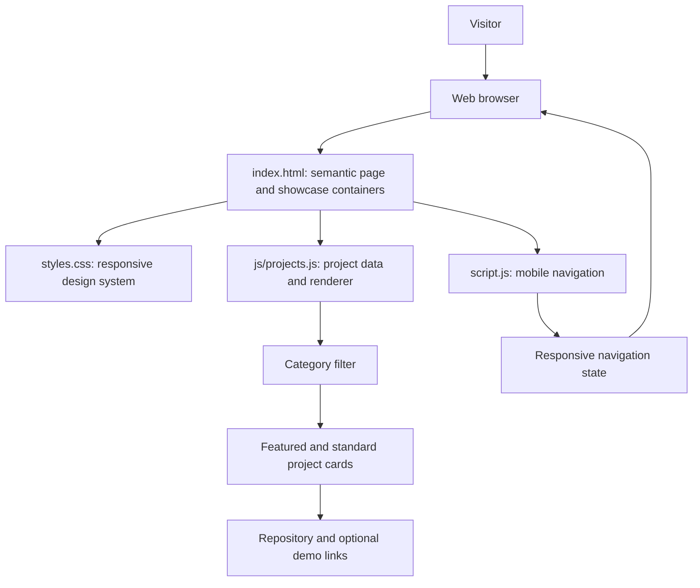
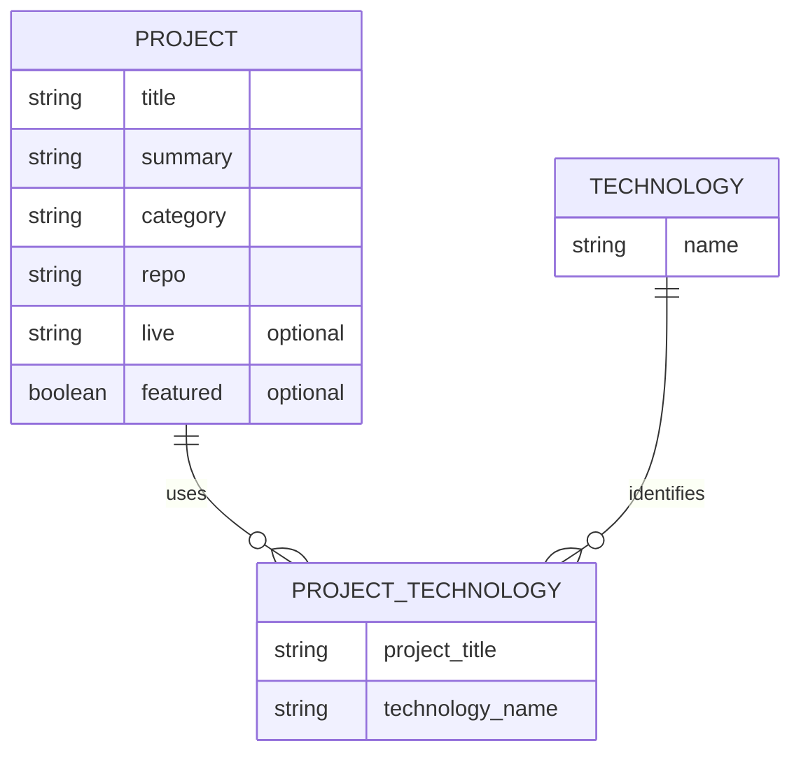

# Portfolio — Case Study

## Case study

This is a responsive, static portfolio for introducing my work, skills, and contact information, with a showcase of the 16 projects I built during a two-week programme. It uses semantic HTML, a responsive CSS design system, and plain JavaScript to render project cards, filter them by category, highlight selected work, and provide a mobile navigation menu. The site has no backend or database; project information is kept in a JavaScript data file. **Live demo:** Not provided. **Repository:** [beatzhubofficial-cpu/01-html-portfolio-main](https://github.com/beatzhubofficial-cpu/01-html-portfolio-main).

## Problem → solution

- **Problem:** A short list of generic cards does not communicate the breadth of a 16-project programme or make it easy to browse projects by technology.
- **Solution:** Keep project details as structured data and render them into a showcase with category filters, a dedicated featured row, stack badges, and repository links.

## Features

- Responsive portfolio layout with About, Skills, Projects, and Contact sections.
- Project cards generated from a JavaScript array rather than duplicated markup.
- All, Frontend, PHP & MySQL, Node.js, and Next.js filters.
- A separate, larger row for featured projects.
- Technology badges and optional repository, live-site, and case-study links.
- Accessible landmarks, skip link, descriptive navigation, keyboard focus indicators, and live filter-result announcements.
- Responsive navigation menu with an announced expanded/collapsed state.
- Light and dark color schemes that follow the visitor's system preference.
- Reduced-motion support.

## Screenshots

Replace these placeholders with captured screenshots before publishing:

> **Screenshot placeholder — desktop:** Add a wide screenshot of the portfolio with the featured projects visible.

> **Screenshot placeholder — mobile:** Add a narrow screenshot showing the responsive layout and project filters.

## Tech stack

| Technology | Why it was used |
| --- | --- |
| HTML5 | Provides semantic page sections, links, navigation, and accessible content without a framework. |
| CSS3 | Implements the responsive layouts, design tokens, card styling, color-scheme adaptation, and reduced-motion behavior in one stylesheet. |
| Vanilla JavaScript | Supports the menu and data-driven project filtering without adding a framework or runtime dependency. |
| GitHub | Hosts the source repository and renders this README as the project case study. |

## Architecture

The site runs in the visitor's browser. There is no application server, database, or external API in this portfolio.

## Data model

Project records and their technology stacks live in memory in `js/projects.js`. This diagram describes that data shape; it is **not** a database schema.

## Security considerations implemented

- Project text is inserted with DOM `textContent`, rather than interpreted as HTML.
- Links that open a new tab use `rel="noopener noreferrer"`.
- The site has no server-side endpoints, database credentials, authentication tokens, or user-submitted data to protect.
- Project links are authored as static data in the repository; no external API response is inserted into the page.

These are measures appropriate to a static portfolio, not a substitute for server-side controls in an application that handles private data.

## Challenges and what I learned

- **Keeping a larger showcase maintainable:** Representing projects as data and using one card-rendering function avoids maintaining 16 separate card templates.
- **Making filters and featured projects work together:** Filtering first, then dividing visible items into featured and standard groups, keeps category results consistent without repeating projects.
- **Making the interactions usable:** Native buttons with `aria-pressed`, an `aria-live` result count, visible focus styles, and reduced-motion support provide useful cues beyond pointer-only interaction.
- **Choosing a lightweight implementation:** Plain HTML, CSS, and JavaScript are sufficient for this static portfolio, so a framework and build pipeline are not necessary.

## Future improvements

- Add and verify a public live-demo URL.
- Replace screenshot placeholders with optimized desktop and mobile captures.
- Verify each programme project's repository URL and replace any remaining username or repository-name placeholders in the showcase data.
- Add automated checks for project data, filter counts, and keyboard navigation.
- Consider adding a search field or sorting control if the project collection grows.
